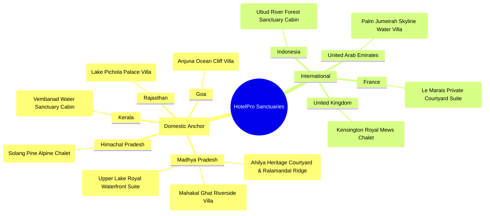
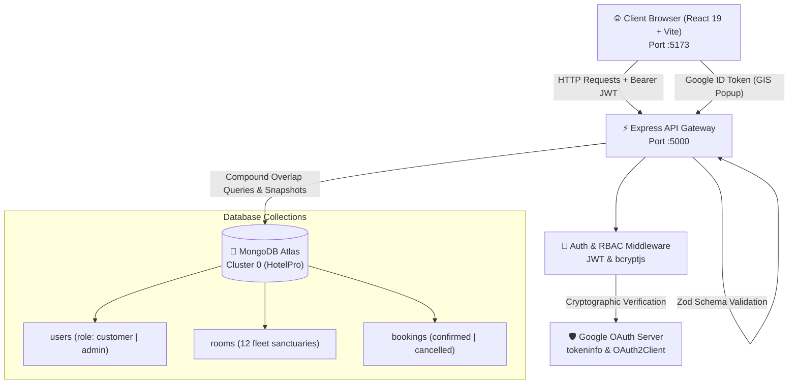
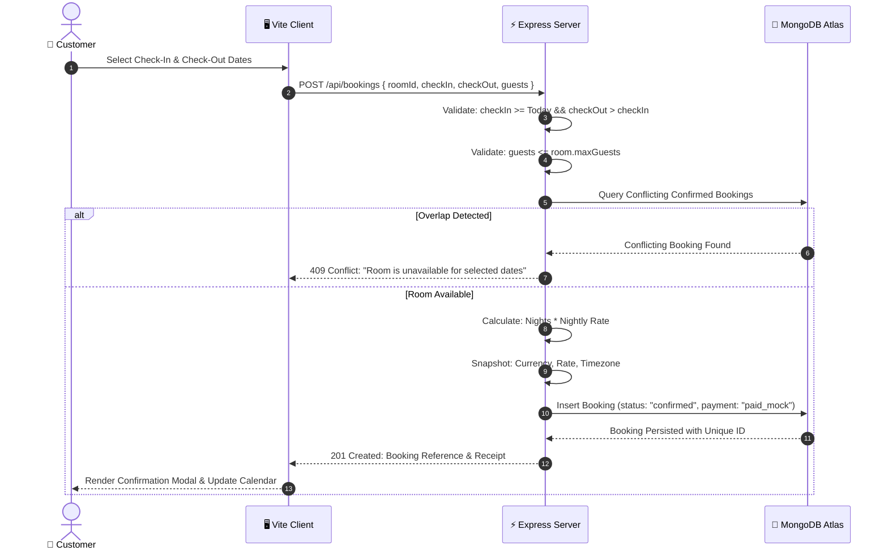
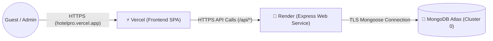

# 🏨 HotelPro — Boutique Hotel Booking & Management System

<div align="center">


[](https://react.dev/)
[](https://www.typescriptlang.org/)
[](https://nodejs.org/)
[](https://expressjs.com/)
[](https://www.mongodb.com/atlas)
[](https://tailwindcss.com/)
[](https://vitejs.dev/)
[](https://opensource.org/licenses/MIT)

<p align="center">
  <b>A full-stack, India-first editorial boutique hotel reservation and sanctuary management platform.</b><br>
  Built with React 19, Express, TypeScript, and MongoDB Atlas as a B.Tech Computer Science Capstone Project at Medi-Caps University.
</p>

[✨ Live Demo](https://hotelpro.luxury) • [📖 Documentation](#-architecture) • [🚀 Quick Start](#-getting-started) • [🔌 API Reference](#-api-overview) • [👤 Author](#-author)

</div>

---

> [!NOTE]
> **Academic Demonstration Project:** Hotel listings are curated sample sanctuaries with authentic architectural demonstration photography, not verified commercial inventory. Financial transactions are simulated using `paid_mock` and `refunded_mock` demonstration states. No real currency is charged.

---

## 📑 Table of Contents
- [✨ Key Features](#-key-features)
- [🌍 Curated Destinations](#-curated-destinations)
- [🛠️ Technology Stack](#️-technology-stack)
- [🏗️ System Architecture & Data Flow](#️-system-architecture--data-flow)
- [📁 Project Structure](#-project-structure)
- [🚀 Getting Started](#-getting-started)
- [📜 Available Scripts](#-available-scripts)
- [🔐 Environment Variables](#-environment-variables)
- [🔌 API Overview](#-api-overview)
- [🧪 Testing & Quality Checklist](#-testing--quality-checklist)
- [🌐 Deployment Guide](#-deployment-guide)
- [⚠️ Limitations & Roadmap](#️-limitations--roadmap)
- [👤 Author & Academic Context](#-author--academic-context)

---

## ✨ Key Features

### 🛎️ Guest Experience
- **Editorial Sanctuary Discovery:** Browse handpicked boutique suites, alpine chalets, ocean cliff villas, and heritage courtyard estates.
- **Dynamic Multi-Criteria Filtering:** Filter listings by destination city, country, sanctuary category, price spectrum, and guest capacity.
- **Rich Room Profiles:** High-resolution architectural photography, verified amenity lists, and property-local operational timezone schedules.
- **Dual Authentication Modes:**
  - Standard email/password registration with 10-round bcrypt hashing.
  - Native **Google Identity Services (GIS)** single sign-on with server-side cryptographic token validation.
- **Financial & Booking Integrity:**
  - Server-calculated night counts and price totals (client totals are never trusted).
  - Snapshotting of agreed transaction currency, nightly rate, total cost, and property timezone.
- **Reservation Lifecycle:** View comprehensive stay receipts, inspect check-in/check-out countdowns, and cancel eligible bookings with automatic mock refund processing.

### 🛡️ Administrator Operations Portal
- **Protected Operations Dashboard:** Hardened with server-side Role-Based Access Control (`requireAdmin` middleware).
- **Fleet Management:** Create, review, activate, deactivate, and edit sanctuary listings with live validation.
- **Global Booking Review:** Comprehensive visibility into all customer reservations, occupancy rates, and transaction statuses.
- **Normalized Financial Analytics:** Aggregate revenue calculation automatically normalized into base Indian Rupees (INR).

### 🔒 Security & Concurrency
- **Overlap Conflict Prevention:** High-performance compound MongoDB queries prevent conflicting reservations on overlapping dates.
- **Cryptographic Token Verification:** Google OAuth ID tokens verified server-side using Google's official `google-auth-library` (`OAuth2Client`).
- **Strict Role Boundaries:** Customer registrations and Google single sign-on flows are strictly quarantined to `customer` roles and cannot elevate to administrator privileges.
- **Fail-Fast Schema Validation:** Incoming payloads strictly validated via Zod schemas before hitting business logic.
- **CORS Whitelisting:** Strict origin validation rejecting unauthorized cross-site requests with `403 Forbidden`.

### 🇮🇳 India-First Localization
- **Featured Anchor Destination:** **Indore, Madhya Pradesh**, featuring the flagship *Ahilya Heritage Courtyard Suite*.
- **Default Display Currency:** Indian Rupee (`₹` / `INR`) formatted using `en-IN` numbering grouping (e.g., `₹14,500 / night`).
- **Multi-Currency Estimation:** Instant toggle between `INR (₹)`, `USD ($)`, `EUR (€)`, `GBP (£)`, and `AED` with transparent exchange-rate labeling.
- **Bilingual Interface:** Instant seamless switching between English (`en`) and Hindi (`hi`, हिन्दी) persisted in `localStorage`.
- **Property-Local Timezones:** Preserves exact calendar dates across Indian Standard Time (`Asia/Kolkata`) and global destinations (`Asia/Dubai`, `Europe/Paris`, `Europe/London`, `Asia/Makassar`).

---

## 🌍 Curated Destinations

HotelPro includes **12 verified luxury demonstration sanctuaries** across prime Indian regions and premier international hubs:



---

## 🛠️ Technology Stack

| Layer | Technology | Version | Purpose / Highlights |
| :--- | :--- | :---: | :--- |
| **Frontend Framework** | React | `^19.3.1` | Modern concurrent rendering, hooks, and clean state modularity |
| **Build Tool** | Vite | `^8.3.4` | Ultra-fast HMR and optimized production bundling |
| **Language** | TypeScript | `~6.0.3` | End-to-end type safety, shared interfaces, and compile-time correctness |
| **Styling** | Tailwind CSS | `^4.3.3` | Custom luxury dark palette, glassmorphism, and responsive layouts |
| **Animation** | Framer Motion | `^14.6.0` | Subtle editorial micro-interactions, page transitions, and drawer physics |
| **Icons** | Lucide React | `^1.61.0` | Lightweight, scalable vector iconography |
| **Localization** | i18next & react-i18next | `^26.5.11` | Complete bilingual dictionary support (English & Hindi) |
| **Backend Runtime** | Node.js | `>=20.x` | High-throughput asynchronous event-driven JavaScript runtime |
| **Web Server** | Express | `^4.21.2` | RESTful API design, modular routing, and centralized error pipeline |
| **Database & ODM** | MongoDB Atlas & Mongoose | `^8.9.5` | Cloud NoSQL persistence, compound indexes, and transactional locking |
| **Authentication** | JWT & bcryptjs | `^9.0.2` | Stateless 7-day session tokens and salted password hashing (10 rounds) |
| **Google Single Sign-On**| Google Identity Services & google-auth-library | `^9.15.1` | Native client popup and server-side cryptographic token verification |
| **Validation** | Zod | `^3.24.2` | Runtime schema enforcement for API requests and environment variables |
| **Process Runner** | Concurrently | `^9.1.2` | One-command root development runner with graceful process management |

---

## 🏗️ System Architecture & Data Flow

HotelPro operates on a decoupled client-server architecture with strict separation of concerns:



### 📅 Booking Availability Concurrency Formula

To ensure zero double-booking, the backend validates incoming date ranges against existing reservations using the standard interval-overlap theorem:

$$\text{Conflict} \iff (\text{newCheckIn} < \text{existingCheckOut}) \land (\text{newCheckOut} > \text{existingCheckIn}) \land (\text{existing.status} = \text{"confirmed"})$$



---

## 📁 Project Structure

```text
HotelPro/
├── client/                               # Frontend Single Page Application
│   ├── public/
│   │   ├── sanctuaries/                  # 12 Verified local sanctuary photographs
│   │   └── favicon.svg                   # Brand icon
│   ├── src/
│   │   ├── assets/                       # UI illustrations and brand assets
│   │   ├── components/                   # Reusable components (Navbar, Footer, Hotspots)
│   │   ├── context/                      # AuthContext, CurrencyContext
│   │   ├── locales/                      # Bilingual translation dictionaries (en, hi)
│   │   ├── pages/                        # Home, Rooms, RoomDetail, Login, Bookings, Admin
│   │   ├── services/                     # Typed Axios/Fetch API layer (auth, rooms, bookings)
│   │   ├── utils/                        # Formatting utilities (currency, dates, timezones)
│   │   ├── App.tsx                       # Client routing and layout tree
│   │   ├── i18n.ts                       # i18next configuration
│   │   └── main.tsx                      # Vite React entrypoint
│   ├── .env.example                      # Sanitized frontend environment template
│   ├── index.html                        # HTML entry with Google Identity SDK
│   ├── package.json                      # Client dependencies & scripts
│   ├── tailwind.config.js                # Editorial luxury dark theme tokens
│   ├── tsconfig.json                     # TypeScript client configuration
│   └── vercel.json                       # SPA client route rewrites for Vercel
│
├── server/                               # Backend REST API Service
│   ├── src/
│   │   ├── config/                       # Database connection, Zod env, exchange rates
│   │   ├── controllers/                  # Handlers: auth, rooms, bookings, admin
│   │   ├── middleware/                   # JWT verification, requireAdmin, errorHandler
│   │   ├── models/                       # Mongoose schemas: User, Room, Booking
│   │   ├── routes/                       # Express routes: /api/auth, /rooms, /bookings, /admin
│   │   ├── seed/                         # Safeguarded database seed script (--confirm)
│   │   └── index.ts                      # Express app initialization and port listener
│   ├── .env.example                      # Sanitized backend environment template
│   ├── package.json                      # Server dependencies & scripts
│   └── tsconfig.json                     # TypeScript server configuration
│
├── package.json                          # Root workspace runner (concurrently scripts)
├── package-lock.json                     # Root lockfile
├── .gitignore                            # Comprehensive secret and build exclusion rules
└── README.md                             # Project documentation
```

---

## 🚀 Getting Started

### Prerequisites
- **Node.js**: `v20.x` or higher (`v24.x` recommended)
- **npm**: `v10.x` or higher
- **MongoDB Atlas**: An active cluster connection URI
- **Google Cloud Console**: An OAuth 2.0 Web Client ID (if testing Google Sign-In)

---

### 1. Clone the Repository
```bash
git clone https://github.com/KKU022/HotelPro.git
cd HotelPro
```

---

### 2. Install Dependencies (One Command)
Run from the root directory:
```bash
npm run install:all
```
*This installs root build dependencies (`concurrently`), backend packages (`server/`), and frontend packages (`client/`) in a single step.*

---

### 3. Configure Environment Variables
Create your local environment configuration files from the provided templates:

**On Windows (PowerShell):**
```powershell
Copy-Item server/.env.example server/.env
Copy-Item client/.env.example client/.env
```

**On macOS / Linux:**
```bash
cp server/.env.example server/.env
cp client/.env.example client/.env
```

#### Backend Configuration (`server/.env`):
```env
PORT=5000
NODE_ENV=development
MONGO_URI=mongodb+srv://<username>:<password>@cluster0.irklf1p.mongodb.net/HotelPro?retryWrites=true&w=majority
JWT_SECRET=your_super_secret_jwt_key_at_least_16_chars_long
CORS_ORIGIN=http://localhost:5173,http://127.0.0.1:5173
ADMIN_PASSWORD=HotelPro@Admin2026!
GOOGLE_CLIENT_ID=your-google-oauth-client-id.apps.googleusercontent.com
```

#### Frontend Configuration (`client/.env`):
```env
VITE_API_URL=http://localhost:5000/api
VITE_GOOGLE_CLIENT_ID=your-google-oauth-client-id.apps.googleusercontent.com
```

> [!WARNING]
> Never commit real `.env` files to Git. `VITE_GOOGLE_CLIENT_ID` is public client configuration, but `MONGO_URI`, `JWT_SECRET`, and Google client secrets must never be placed in frontend variables or tracked files.

---

### 4. Database Seeding (Optional Safeguarded Reset)
The database seed script provisions 12 curated sanctuaries, sample users, and an active reservation. It enforces a safety flag (`--confirm`) to prevent accidental data wipes:

```bash
cd server
npm run seed -- --confirm
```

---

### 5. Launch the Integrated Application (One Command)
From the root repository directory:
```bash
npm run dev
```

The integrated runner launches both servers with color-coded logging:
- **Frontend SPA**: [http://localhost:5173](http://localhost:5173) `[CLIENT]`
- **Express Backend API**: [http://localhost:5000](http://localhost:5000) `[SERVER]`
- **API Health Endpoint**: [http://localhost:5000/api/health](http://localhost:5000/api/health)

Pressing `Ctrl + C` cleanly terminates both processes together.

---

## 📜 Available Scripts

| Scope | Command | Description |
| :--- | :--- | :--- |
| **Root** | `npm run dev` | Concurrently runs backend (:5000) and frontend (:5173) with color-coded prefix output |
| **Root** | `npm run build` | Sequentially builds production bundles for both backend (`tsc`) and frontend (`vite`) |
| **Root** | `npm run install:all` | Installs dependencies across root, server, and client directories |
| **Root** | `npm run seed` | Executes the database seed script into MongoDB Atlas with `--confirm` flag |
| **Server** | `npm run dev` | Starts backend in watch mode using `tsx watch src/index.ts` |
| **Server** | `npm run build` | Compiles backend TypeScript into `server/dist/` |
| **Server** | `npm start` | Runs compiled production backend from `server/dist/index.js` |
| **Client** | `npm run dev` | Starts Vite development server at `http://localhost:5173` |
| **Client** | `npm run build` | Validates TypeScript (`tsc -b`) and compiles production assets into `client/dist/` |

---

## 🔐 Evaluation & Viva Test Credentials

The sign-in interface includes convenient **One-Click Quick-Fill** buttons for rapid evaluation during presentations:

| Role | Email | Password | Permissions & Capabilities |
| :--- | :--- | :--- | :--- |
| **General Manager (Admin)** | `admin@hotelpro.luxury` | `HotelPro@Admin2026!` | Full fleet CRUD, active/inactive toggles, global bookings review, normalized revenue metrics |
| **Customer (Guest)** | `alexander@example.com` | `GuestPass2026!` | Search, book suites, view historical booking receipts, cancel reservations with mock refund |

---

## 🔌 API Overview

### Public & Authentication Endpoints
| Method | Route | Access | Description | Status Codes |
| :---: | :--- | :---: | :--- | :---: |
| `GET` | `/api/health` | Public | System uptime & MongoDB connection status | `200` |
| `POST` | `/api/auth/register` | Public | Create new customer profile (Bcrypt 10 rounds) | `201`, `400`, `409` |
| `POST` | `/api/auth/login` | Public | Authenticate email/password & issue JWT | `200`, `400`, `401` |
| `POST` | `/api/auth/google` | Public | Verify Google ID token via `google-auth-library` | `200`, `401`, `503` |
| `GET` | `/api/auth/me` | Customer / Admin | Retrieve current authenticated session profile | `200`, `401`, `404` |

### Sanctuaries (Rooms) Endpoints
| Method | Route | Access | Description | Status Codes |
| :---: | :--- | :---: | :--- | :---: |
| `GET` | `/api/rooms` | Public | Discover active properties (filter by country, city, price) | `200` |
| `GET` | `/api/rooms/:id` | Public | Retrieve full details, amenities, and timezone of a sanctuary | `200`, `404` |
| `GET` | `/api/destinations` | Public | Taxonomy of available countries and cities | `200` |

### Reservations (Bookings) Endpoints
| Method | Route | Access | Description | Status Codes |
| :---: | :--- | :---: | :--- | :---: |
| `POST` | `/api/bookings` | Customer | Create reservation with overlap & capacity checks | `201`, `400`, `409` |
| `GET` | `/api/bookings/my` | Customer | Retrieve customer's personal booking history | `200`, `401` |
| `GET` | `/api/bookings/:id` | Owner / Admin | Retrieve detailed stay receipt | `200`, `403`, `404` |
| `PATCH`| `/api/bookings/:id/cancel` | Owner / Admin | Cancel stay & transition payment to `refunded_mock` | `200`, `400`, `403` |

### Administrator Endpoints
| Method | Route | Access | Description | Status Codes |
| :---: | :--- | :---: | :--- | :---: |
| `GET` | `/api/admin/metrics` | Admin Only | Total fleet count, active stays, and INR normalized revenue | `200`, `403` |
| `GET` | `/api/admin/bookings`| Admin Only | Global review of all guest reservations across all properties | `200`, `403` |
| `POST` | `/api/rooms` | Admin Only | Provision a new sanctuary listing | `201`, `400`, `403` |
| `PATCH`| `/api/rooms/:id` | Admin Only | Update sanctuary details, nightly pricing, or active state | `200`, `400`, `403` |

---

## 🧪 Testing & Quality Checklist

- [x] **One-Command Build:** `npm run build` succeeds from the root with zero TypeScript errors.
- [x] **Health Check:** `GET /api/health` reports `{ "status": "ok", "db": "connected" }`.
- [x] **Live Database:** Verified connection to MongoDB Atlas Cluster 0 (`irklf1p.mongodb.net`).
- [x] **Password Security:** Salted with bcrypt (10 rounds); hashes never returned in API responses.
- [x] **Google Single Sign-On:** Validates audience against `GOOGLE_CLIENT_ID`; forged tokens rejected with `401 Unauthorized`.
- [x] **RBAC Isolation:** Customers accessing `/api/admin/*` receive `403 Forbidden`.
- [x] **Overlap Prevention:** Conflicting reservations for the same room on identical dates trigger `409 Conflict`.
- [x] **Date Validation:** Past check-in dates and check-out dates prior to check-in are rejected with `400 Bad Request`.
- [x] **Financial Snapshots:** Historical bookings preserve agreed rates, currencies, and timestamps indefinitely.
- [x] **Bilingual Support:** Full English / Hindi toggle persisted across reloads via `localStorage`.

---

## 🌐 Deployment Guide

HotelPro is optimized for zero-cost decoupled deployment:



### 1. Backend Service (Render)
- **Repository**: `https://github.com/KKU022/HotelPro.git`
- **Root Directory**: `server`
- **Build Command**: `npm install && npm run build`
- **Start Command**: `npm start`
- **Environment Variables**:
  - `NODE_ENV`: `production`
  - `PORT`: `10000`
  - `MONGO_URI`: `mongodb+srv://...`
  - `JWT_SECRET`: `<secure-key>`
  - `CORS_ORIGIN`: `https://your-hotelpro-frontend.vercel.app`
  - `GOOGLE_CLIENT_ID`: `your-id.apps.googleusercontent.com`

### 2. Frontend Client (Vercel)
- **Repository**: `https://github.com/KKU022/HotelPro.git`
- **Framework Preset**: `Vite`
- **Root Directory**: `client`
- **Build Command**: `npm run build`
- **Output Directory**: `dist`
- **Environment Variables**:
  - `VITE_API_URL`: `https://your-hotelpro-backend.onrender.com/api`
  - `VITE_GOOGLE_CLIENT_ID`: `your-id.apps.googleusercontent.com`
- **SPA Deep Linking**: Covered by `client/vercel.json` rewrites.

---

## ⚠️ Limitations & Roadmap

### Project Limitations
- **Demo Inventory:** Properties are curated demonstration samples; no real hotel partnerships or live inventory scraping exist.
- **Simulated Payments:** Financial flows use demonstration statuses (`paid_mock` / `refunded_mock`) without real credit card processing.
- **Static Rate Estimation:** International currency rates use a documented baseline matrix rather than real-time forex feeds.

### Future Roadmap
- [ ] Integration of live payment gateways (Stripe / Razorpay).
- [ ] Automated SMS & Email booking confirmations via Twilio & SendGrid.
- [ ] Interactive 3D WebGL sanctuary room tours using Three.js.
- [ ] Automated end-to-end integration test suites with Playwright.
- [ ] Advanced seasonal occupancy heatmaps and dynamic pricing rules.

---

## 👤 Author & Academic Context

<div align="center">

### **Krishna Kant Upadhyay**
**B.Tech in Computer Science & Engineering**  
**Medi-Caps University, Indore, Madhya Pradesh, India**  
*Full-Stack Web Development • Distributed Systems • Hospitality Engineering*

[](https://github.com/KKU022)
[](https://github.com/KKU022/HotelPro)

---

*HotelPro — Thoughtful discovery, reliable reservations, and modern editorial luxury hospitality.*

</div>
